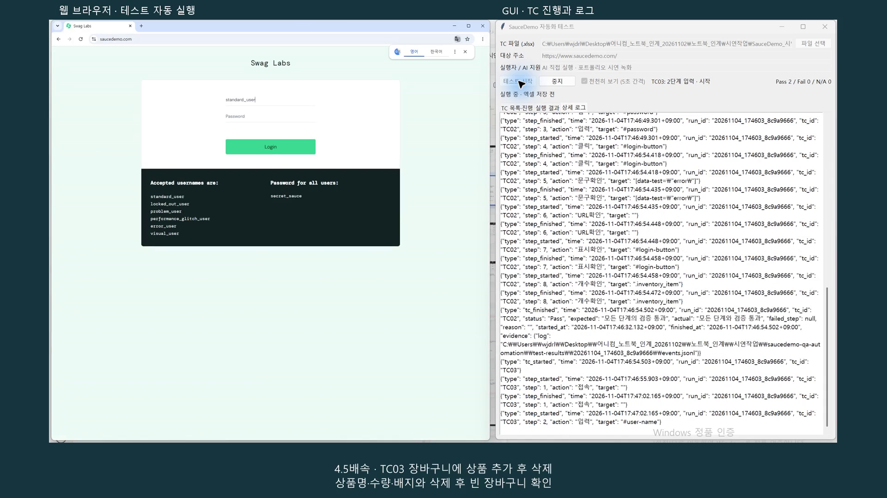
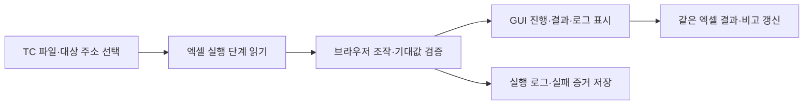

# SauceDemo 엑셀 기반 웹 자동화 테스트

Python·Playwright로 공개 연습용 쇼핑몰 **SauceDemo의 로그인·장바구니·주문 흐름**을 검증하는 개인 프로젝트입니다.

프로그램에서 TC 엑셀 파일과 대상 주소를 선택하면 실행 단계 시트에 정의한 동작과 검증을 순서대로 수행합니다. 진행 상태와 로그를 창에서 확인하고, 선택한 엑셀 파일의 결과·비고에 판정과 실패 사유를 기록합니다.

## 제작 목적

- 기존 Python·Selenium 업무 경험을 바탕으로 Playwright 웹 자동화를 학습합니다.
- 엑셀 TC의 입력값·절차·기대값을 실제 브라우저 동작과 연결합니다.
- 테스트 실행부터 결과 확인·실패 증거 저장까지 한 흐름으로 확인합니다.

기존 카메라 웹 뷰어 QA 업무와 구분되는 개인 학습 프로젝트입니다.

## 시연

[](https://youtu.be/2lQP1nEzxvo)

[시연 영상 보기](https://youtu.be/2lQP1nEzxvo) · [실행용 TC 엑셀](SauceDemo_TC_실행용_v2.xlsx)

영상은 AI가 수행한 시연 녹화이며, 아래의 본인 직접 실행 기록과 구분합니다.

## 주요 기능

| 기능 | 동작 |
|---|---|
| 엑셀 기반 실행 | TC-ID와 순서에 따라 접속·입력·클릭·검증 수행 |
| 실행 전 입력 검사 | 잘못된 동작·순서·대상·기대값 등을 시트·행 정보와 함께 안내 |
| 브라우저 검증 | URL, 요소 표시, 문구, 개수, 저장값과 현재 문구·금액 비교 |
| TC 상태 분리 | TC마다 새 브라우저 컨텍스트를 생성해 로그인·쿠키 상태 분리 |
| GUI 진행 표시 | TC 목록·진행 / 실행 결과 / 상세 로그의 세 탭 제공 |
| 결과 자동 기록 | 같은 엑셀의 결과에 Pass/Fail/N/A, 비고에 Fail·N/A 사유·증거 경로 저장 |
| 중지·실패 처리 | 중지된 미완료 TC는 N/A. Fail인 TC 이후 다음 TC 진행. 자동 TC 재시도 없음 |
| 증거 보관 | 실행 로그·요약 저장, 실패 시 스크린샷·Trace 수집 및 저장 오류 안내 |

테스트 판정과 엑셀 저장 성공 여부는 별도로 표시합니다.

## 테스트 범위

| TC-ID | 시나리오 | 주요 통과 기준 |
|---|---|---|
| TC01 | 정상 로그인 | 상품 목록 URL로 이동하고 상품 카드 표시 |
| TC02 | 잠긴 계정 로그인 | 잠금 오류 문구, 로그인 화면 유지, 상품 카드 0개 |
| TC03 | 상품 추가·삭제 | 상품명·수량·배지 확인 및 삭제 후 빈 장바구니 |
| TC04 | 우편번호 누락 | 필수 입력 오류 표시, 주문 확인 단계로 이동하지 않음 |
| TC05 | 상품 1개 정상 주문 | 상품명·수량·세전 소계가 장바구니와 일치하고 주문 완료 |

TC01 → TC05 순서로 실행하지만 앞선 TC의 로그인 상태나 저장값에 의존하지 않습니다. TC02·TC04처럼 잘못된 요청을 의도대로 차단한 경우도 **Pass**입니다.

## 동작 구조



| 구성 | 역할 |
|---|---|
| [app.py](app.py) | Tkinter 창, 작업 스레드·이벤트 큐, 실행·중지·저장 연결 |
| [excel_io.py](excel_io.py) | openpyxl로 엑셀 읽기·입력 검사·결과 갱신 |
| [step_runner.py](step_runner.py) | Playwright 동작·검증, TC 상태 분리, 판정·증거 처리 |
| [run_gui.cmd](run_gui.cmd) | 프로젝트 가상환경·Chromium 경로를 사용해 창 실행 |
| [tests](tests) | 개발용 검사와 실제 사이트 검사 |

## 대표 사례: TC05 상품 소계 비교

1. 장바구니의 상품명·수량·금액을 읽어 해당 TC 안에 저장합니다.
2. 주문 확인 화면으로 이동해 화면 표시를 확인합니다.
3. 저장한 값과 현재 화면의 상품명·수량·세전 소계를 비교합니다.
4. 주문 완료 문구까지 확인한 뒤 Pass로 판정합니다.

상품 1개·수량 1의 `$29.99`를 `Item total: $29.99`와 비교합니다. 세금이 포함된 `Total`과는 비교하지 않습니다.

```python
# step_runner.py의 저장금액확인 동작 중 비교 부분
actual = _usd_amount(locator.inner_text())
if actual != expected:
    raise _SavedComparisonError(key, expected, actual)
```

금액은 Decimal로 처리하며, 불일치 시 저장 이름·기대값·관찰값을 기록합니다. [TC05 구현·검증 기록](evidence/20261029_tc05_ai/README.md)

## 설치와 실행

Windows에서 Git과 Python 3.12가 필요합니다. 첫 설치에는 인터넷 연결이 필요하며 가상환경·Chromium은 PC마다 새로 설치합니다. 패키지 버전은 [requirements.txt](requirements.txt)에 고정했습니다.

```powershell
git clone https://github.com/jkjun1234/saucedemo-qa-automation.git
Set-Location -LiteralPath '.\saucedemo-qa-automation'
py -3.12 -m venv .venv
.\.venv\Scripts\python.exe -m pip install -r requirements.txt
$env:PLAYWRIGHT_BROWSERS_PATH = Join-Path (Get-Location).Path '.browsers'
.\.venv\Scripts\python.exe -m playwright install chromium
.\run_gui.cmd
```

설치 후에는 `run_gui.cmd`를 더블클릭할 수 있습니다.

1. Excel/Calc에서 TC 파일을 닫고, 프로그램에서 `SauceDemo_TC_실행용_v2.xlsx`를 선택합니다.
2. 대상 주소 `https://www.saucedemo.com/`와 실제 실행자를 입력합니다.
3. **테스트 시작**을 누르고 진행·결과·상세 로그를 확인합니다.
4. 기본 선택된 **천천히 보기(5초 간격)**로 브라우저 입력·클릭을 관찰할 수 있습니다.
5. 종료 후 **엑셀 저장 완료**를 확인하고 같은 파일의 결과·비고를 확인합니다.

실행하면 선택한 TC 파일의 이전 결과·비고가 갱신됩니다. Pass인 TC는 이전 실패 비고를 지우며 실행 대상이 아닌 행은 유지합니다. 중지는 현재 동작 종료 또는 제한시간 이후 반영됩니다. 코드나 단계를 수정했다면 프로그램을 닫고 다시 실행합니다.

## 실행 결과와 기여 범위

| 구분 | 확인한 내용 |
|---|---|
| 본인 수행 | 초기 TC01 코드 입력·수정·응용, TC·코드 검토, 수동 확인 및 자동화 실행·결과 확인 |
| AI 지원 | 초기 예시·설명, 실행기·GUI·후속 TC 구현, 개발 검사·문서 정리 |
| 본인 전체 실행 | 2026-10-30 두 차례 실행했다고 확인. 두 번째 실행에서 TC01~05 모두 Pass·엑셀 저장 완료 |
| AI 검증 근거 | 2026-10-29 개발 검사 64개 + 사이트 검사 6개 통과. 서로 다른 업무 시나리오는 5개 |

본인 전체 실행은 실행 기록 확인과 본인 보고를 바탕으로 정리했습니다. 첫 실행의 TC05 Fail은 실행 중 브라우저를 직접 조작했다는 보고가 있으나, 그것을 확정 원인으로 단정하지 않습니다. 전체 코드의 직접 작성·이해 완료를 의미하지 않습니다.

- [AI 전체 TC 실행 요약](evidence/20261029_tc05_ai/all-tc-summary.json)
- [개발 검사·TC05 증거 설명](evidence/20261029_tc05_ai/README.md)
- [초기 TC01 본인 재실행 로그](tc01_second_run_20260930.txt)

새 실행의 증거는 `test-results/<실행ID>/`에 생성됩니다. `events.jsonl`은 단계 로그, `run-summary.json`은 실행자·결과·엑셀 저장 여부를 담습니다. 실패 시 저장 가능한 스크린샷·Trace 경로도 확인할 수 있습니다.

## 적용 범위와 상세 문서

- 프로젝트의 엑셀 규격과 지원 동작을 사용합니다. 자연어 TC나 임의 장비를 자동 해석하지 않습니다.
- 새 절차는 실행 단계 시트에 작성합니다. 지원하지 않는 동작은 코드 확장이 필요하며 공통 절차 호출 기능은 없습니다.
- 금액 비교는 단일 상품·수량 1과 달러 소수 두 자리 형식이 대상입니다.
- Windows·Chromium 웹 자동화 범위이며 VMS·모바일·다중 브라우저·CI 검증 실적으로 확대하지 않습니다.
- 별도 선택자 오류 분석 실습은 미완료입니다. Trace 저장 기능 구현과 분석 실습 완료는 구분합니다.

[엑셀 규격·지원 동작·결과 처리](docs/workbook-format.md) · [이전 학습·개발 기록](docs/development-history.md)

공식 참고: [Playwright Python](https://playwright.dev/python/docs/intro) · [요소 선택](https://playwright.dev/python/docs/locators) · [Trace Viewer](https://playwright.dev/python/docs/trace-viewer-intro)
